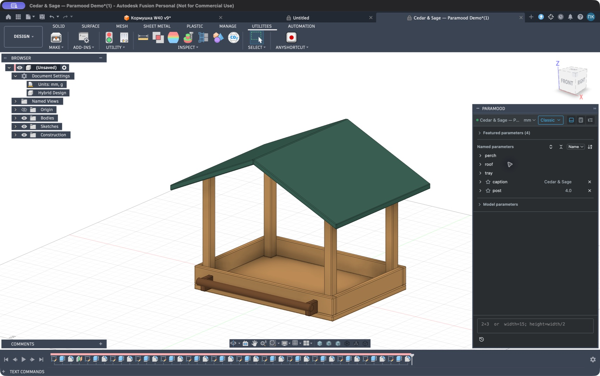
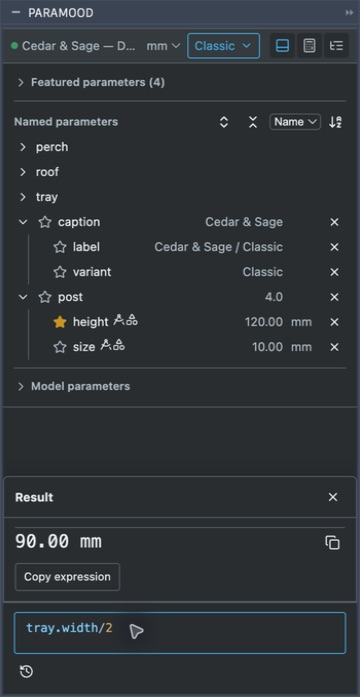
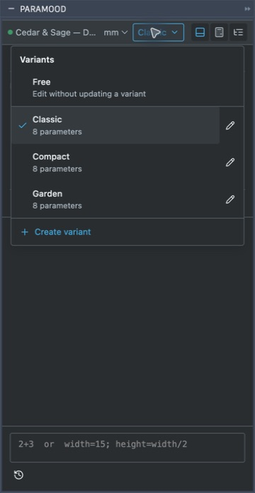

<h1 align="center">Paramood — Parameter Manager for Autodesk Fusion</h1>
<p align="center">
  <strong>Keeper of Measure. Every dimension has a reason.</strong><br>
  Edit Autodesk Fusion parameters, formulas, and model variants while keeping your design visible.
</p>

<p align="center">
  
</p>

<p align="center">
  <a href="README.ru.md">Русский</a> ·
  <a href="https://github.com/4FusionLab/Paramood/releases">Download</a> ·
  <a href="https://github.com/4FusionLab/Paramood/issues">Issues & feedback</a>
</p>

<p align="center">
  <a href="https://github.com/4FusionLab/Paramood/actions/workflows/ci.yml"></a>
</p>

## Manage Fusion parameters without leaving your model

Paramood is an add-in for **Autodesk Fusion**, formerly Fusion 360, that puts a parameter editor, calculator, and browsable parameter list into **one Fusion palette**. Create and edit user parameters, inspect model dimensions, and work with formulas while your design remains visible. Define several dimensions at once, inspect the preview, and apply changes without navigating the native Parameters dialog for every edit.

The idea is simple: **use the precision of parametric CAD with the speed of an IDE**. Paramood is an interface over real Fusion parameters, not a separate parameter storage system.

**Before editing:** Paramood changes to configured parameters update the active variant automatically; parameters outside the configured set remain global. Choose **Free** to leave saved variants unchanged. Applied values are kept even if a downstream Fusion feature fails; inspect geometry and the timeline before saving or sharing a configuration.

## One palette for the parameter list and input

The default **Hybrid** view keeps the parameter list visible and the shared input fixed at the bottom. Results, recent calculations, and assignment previews open in a dismissible panel above the input. **Calculator** and **Parameter list** remain available as separate views; switching views preserves your input.

The header shows the current design, its length units, and the active variant. Synchronization with Fusion is automatic.

## In Autodesk Fusion

The supplied Cedar & Sage F3D opened in the installed add-in, with **Classic** selected. These are real Fusion screenshots on macOS.



The palette keeps input below the list and opens results above it. The variant menu switches between the three configurations stored in the example.

 

## Paramood 1.5.0 capabilities

This overview describes the v1.5.0 source. The [Releases page](https://github.com/4FusionLab/Paramood/releases) lists published builds; check the installed version’s release notes when comparing features.

| Area | Capability |
| --- | --- |
| **Quick input** | One field for calculations and parameter assignments. Expressions without `=` are evaluated; assignments open a preview and require an explicit **Apply parameters** action. |
| **Batch parameters** | Create and update parameters from semicolon-separated definitions, preserving formula references. |
| **IntelliSense** | CodeMirror completion for parameters, virtual paths, all 26 Fusion functions and four constants; nested Signature Help, active arguments, and conservative diagnostics. [Expression reference](docs/EXPRESSION_REFERENCE.md). |
| **Parameter browser** | A collapsible, hierarchical list of named parameters and Fusion-generated model parameters, with displayed values and units. |
| **Inline editing** | Click a value to edit with IntelliSense. Press **Enter** to validate and apply or **Escape** to cancel. |
| **Naming and dependencies** | Click an editable parameter name to rename it. A model value such as `20 (d_min)` shows its expression; driven sketch dimensions are displayed in parentheses and are read-only. |
| **Create while editing** | Enter a new name, `name=25`, or a supported equation such as `-name/5=50` in an editable value to create and link a new parameter. |
| **Parameter removal** | Delete individual parameters from the list when Fusion permits it; failed or unsupported deletions return an error. |
| **Model awareness** | Refresh on document changes; show indicators for known sketch, feature, or other parameter links. |
| **Calculator** | Evaluate expressions against the current design, see formatted results, reuse recent calculations, and copy results or expressions. |
| **Saved variants** | Named sets of existing parameter expressions, stored in the design and carried with an F3D export. Switch sizes or configurations from the header. |
| **Text parameters** | Quoted text, references, concatenation, and supported conditional expressions; the list shows the computed text while editing preserves the formula. |
| **Model units** | Select `mm`, `cm`, `m`, `in`, or `ft` beside the design name without changing physical sizes. |

### A short example

Type the following in the Paramood field:

```text
box.inner.size = 25mm; box.width = box.inner.size * 2
```

Paramood presents the definitions for review. After you apply them, the **actual Fusion parameter names** are `box_inner_size` and `box_width`; the dotted syntax is a readable virtual view of those names. Fusion continues to store and evaluate ordinary parameter expressions.

The virtual hierarchy is also used for completion:

| Fusion parameter | Paramood editor |
| --- | --- |
| `box_size` | `box.size` |
| `box_wall_thickness` | `box.wall.thickness` |
| `box_width` | `box.width` |

Typing `b` prioritizes `box`. Typing `box.` narrows the suggestions to its members. Original underscore-separated names remain usable.

Other supported workflows include:

```text
2 + 3                 # calculate, without changing the model
width = 15mm          # preview then create/update
width += 2mm          # modify an existing expression
height = width / 2    # retain the parameter dependency
```

These are separate examples: enter the expression or definition without the explanatory comments.

### Create a parameter while editing a value

Click an editable value in the parameter tree. The inline editor supports the same parameter completion and virtual dotted names as the main editor.

| Input | Result |
| --- | --- |
| `height` | If `height` exists, link to it. If it is new, create it from the edited parameter's current value and link to it. |
| `height=25` | Create `height` with value 25 and link to it. A bare number uses the edited parameter's unit. |
| `-height/5=50` | Create `height=-250` and set the edited expression to `-height/5`, yielding 50 in its unit. |

Creation and linking are validated together. Equation solving supports one new name multiplied or divided by numbers or existing dimensionless parameters; other forms are rejected. When a Fusion command or sketch edit prevents a transaction, finish it before creating and linking a parameter. Existing names are never overwritten by a new definition.

## Save and switch variants

The 2.0 variant editor is awaiting the owner's personal review; release is not yet authorized.

1. Open **Free → Create variant**, or the pencil beside an existing variant.
2. Use **Configure** to choose the model-wide set of parameters and timeline features.
3. Variants are always rows; parameters and features are always columns. Click a value to
   edit that variant's expression. A checked feature is **Enabled**; unchecked is **Suppressed**.
   Drag handles reorder parameters and variants.
4. **Save** stores the complete table and applies the edited active variant. Other variants are
   saved without switching. **Cancel** lets you discard the draft without changing the model.

Controlled parameters have a small table icon in the common list. Parameters outside the set
remain global and are never enrolled automatically. **Free** keeps the current geometry and lets
parameter edits leave saved variants unchanged. The switcher keeps its existing interaction.

Format 2 is stored separately in the model: old 1.x variants are not read or migrated.
The Cedar & Sage example and older screenshots describe 1.x; recreate its variants for 2.0.
See [Variants 2.0](docs/VARIANTS_V2.md) for workflow, verification and limitations.

## Create text parameters

Enter a quoted value without selecting a type:

```text
caption = 'Body'
```

Double quotes are accepted too: `caption="Body"`. Paramood converts them to Fusion's single-quoted syntax. References and formulas remain editable:

```text
label = caption + ' / ' + 'Compact'
```

A supported conditional expression is `label=if(width<20 mm; 'Short'; 'Long')`, where `width` is an existing length parameter. Semicolons and equals signs inside quoted text are content. Existing numeric parameters cannot be converted to text, or text parameters to numbers. See the [user guide](docs/USER_GUIDE.md) for escapes, units, variants, and limitations.

## Install the Fusion 360 add-in

1. Download the latest **Paramood ZIP** from [Releases](https://github.com/4FusionLab/Paramood/releases), then extract it.
2. In Autodesk Fusion, open **Utilities → Scripts and Add-Ins → Add-Ins**.
3. Click **+**, select the extracted `Paramood` folder, then select **Paramood** and click **Run**.
4. Enable **Run on Startup**. Paramood opens as a dockable palette; use the **Paramood** toolbar command to reopen it.

The packaged add-in includes the compiled frontend. **Node.js is not required for installation.**

## Compatibility and boundaries

- **Platforms:** Windows and macOS are declared in the manifest. Automated checks run on both (and Linux); interactive Fusion testing has been performed on macOS, while native Windows validation remains outstanding.
- **Scope:** the active Fusion design. User parameters and editable model parameters are supported where Fusion allows changes; parameters in externally linked components are not edited.
- **Safety:** assignment previews are validated again against the current document before applying. Unsupported expressions, dimensions, and stale previews are rejected rather than guessed. Fusion may still report downstream feature errors after a legitimate parameter change. Timeline errors and warnings do not cause Paramood to roll back an applied value or variant; inspect the geometry after switching.
- **Deletion:** per-parameter deletion is available, subject to Fusion's restrictions. **Automatic unused-parameter cleanup is not available in the current release.**
- **Known limitations:** expression and unit support is intentionally conservative. Virtual dotted names do not create objects inside Fusion; they are a convenience in Paramood.

## Frequently asked questions

### Can I edit user parameters and model parameters in Autodesk Fusion?

Yes. Paramood lists user parameters and model parameters and lets you edit values where Fusion permits it. Driven sketch dimensions are shown in parentheses and cannot be edited from the palette.

### Can I use formulas and reference other parameters?

Yes. Enter an expression such as `height=width/2` to retain a dependency on `width`. The editor offers parameter completion, and the preview checks assignments before they are applied.

### Does the add-in work on Windows and macOS?

The package declares support for both platforms, and automated checks run on both. Interactive testing inside Fusion has been performed on macOS; native Windows validation remains outstanding.

## Guides and release notes

- [User guide](docs/USER_GUIDE.md): input, units, variants, text, and boundaries.
- [Cedar & Sage walkthrough](docs/DEMO.md): a feeder model and parameter-group examples.
- [Published releases](https://github.com/4FusionLab/Paramood/releases) and [1.5.0 release notes](docs/releases/1.5.0.md): published builds and the source version described here.
- [Product concept](docs/PRODUCT_CONCEPT.md) and [IntelliSense details](docs/INTELLISENSE.md).

## Build from source

Development uses **Node.js 22.12+** and Python; the CI Python environment is **3.14**.

```sh
cd frontend
npm ci
npm run lint
npm run format:check
npm test
npm run build
cd ..
python -m pip install pytest ruff==0.17.3
python -m ruff check Paramood scripts tests
python -m ruff format --check Paramood scripts tests
npm test
python -m pytest -q
python scripts/build_release.py
```

The release builder creates `dist/Paramood-<version>.zip` and a matching `.sha256` file. GitVersion computes release versions from tags and Conventional Commit messages. After successful CI checks, pushes to `main` can publish when shipped runtime changes are eligible. A documentation-only push can also retry an earlier missed runtime release; documentation alone does not create a release.

**Tech stack:** Fusion Python API · Preact · TypeScript · CodeMirror 6 · Vite · Vitest · Pytest.

## Part of 4FusionLab

**[Perfora](https://github.com/4FusionLab/Perfora)** · **[Selectra](https://github.com/4FusionLab/Selectra)** · **[Ejix](https://github.com/4FusionLab/Ejix)** · **[RuEn](https://github.com/4FusionLab/RuEn)** · **[Planara](https://github.com/4FusionLab/Planara)**

Paramood is an independent [4FusionLab](https://github.com/4FusionLab) project and is not affiliated with Autodesk.

## License

Paramood is available under the [PolyForm Noncommercial License 1.0.0](LICENSE). Commercial use outside its permitted purposes requires a separate agreement with 4FusionLab. Third-party components remain subject to their own licenses.

[Acceptance results and platform limits](docs/ACCEPTANCE.md).
