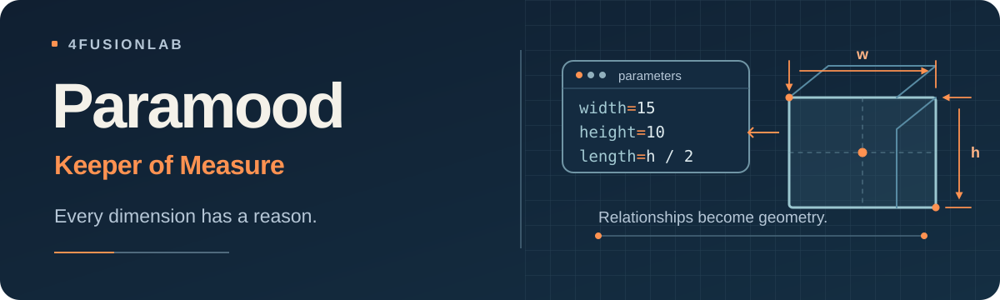
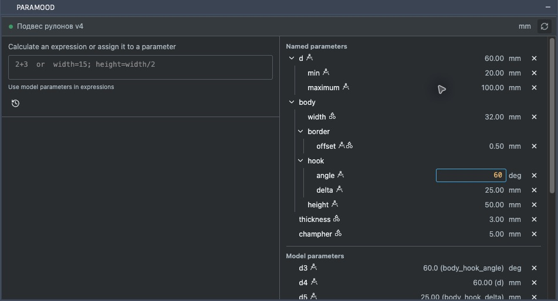
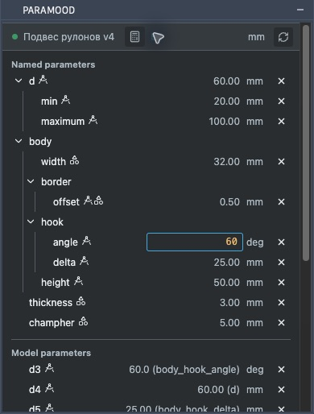
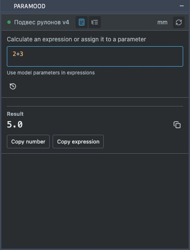

<p align="center">
  
</p>

<h1 align="center">Paramood — менеджер параметров для Autodesk Fusion</h1>
<p align="center">
  <strong>Keeper of Measure. У каждого размера есть смысл.</strong><br>
  Надстройка Fusion 360 для работы с параметрами, формулами и размерами в компактной палитре.
</p>

<p align="center">
  <a href="README.md">English</a> ·
  <a href="https://github.com/4FusionLab/Paramood/releases">Скачать</a> ·
  <a href="https://github.com/4FusionLab/Paramood/issues">Ошибки и предложения</a>
</p>

<p align="center">
  <a href="https://github.com/4FusionLab/Paramood/actions/workflows/ci.yml"></a>
</p>

## Управление параметрами Fusion без выхода из модели

Paramood — надстройка для **Autodesk Fusion**, ранее Fusion 360, которая объединяет **редактор параметров, калькулятор и дерево параметров в одной палитре**. Она помогает создавать и изменять пользовательские параметры, просматривать размеры модели и работать с формулами, не закрывая модель. Можно задавать сразу несколько размеров, проверять предпросмотр и применять изменения без постоянных переходов в штатный диалог Parameters.

Идея проекта — **скорость работы IDE при точности параметрического CAD**. Paramood не создаёт собственную систему параметров, а работает с реальными параметрами Fusion.

## Скриншоты палитры параметров Fusion

Палитра подстраивается под ширину: в широком режиме калькулятор и дерево параметров расположены рядом, в компактном — переключаются вкладками.

**Двухколоночный вид**



**Компактный вид**

 

## Что уже реализовано

| Функция | Возможности |
| --- | --- |
| **Единое поле** | Ввод без `=` вычисляет выражение; присваивание запускает предпросмотр и требует явного нажатия **Apply parameters**. |
| **Пакетное редактирование** | Создание и изменение нескольких параметров через `;` с сохранением формул и зависимостей. |
| **IntelliSense** | Автодополнение CodeMirror с виртуальными вложенными именами и управлением с клавиатуры. |
| **Дерево параметров** | Сворачиваемые группы именованных параметров и автоматически созданных Fusion model parameters, значения и единицы. |
| **Редактирование в списке** | Нажатие на значение открывает редактор с IntelliSense; **Enter** применяет после проверки, **Escape** отменяет. |
| **Имена и зависимости** | Нажатие на имя доступного параметра открывает переименование. Запись `20 (d_min)` показывает выражение размера; справочные размеры эскиза отображаются в скобках и доступны только для чтения. |
| **Создание из строки** | Введи новое имя, `name=25` или поддерживаемое уравнение вида `-name/5=50`, чтобы создать параметр и связать его с редактируемым. |
| **Удаление** | По одному параметру из списка, если Fusion разрешает удаление; при отказе отображается ошибка. |
| **Связи с моделью** | Обновление при смене документа и индикаторы обнаруженных связей с эскизами, операциями и другими элементами. |
| **Калькулятор** | Вычисления с параметрами текущей модели, история последних выражений, копирование результата и формулы. |

### Пример использования

Введи в поле Paramood:

```text
box.inner.size = 25mm; box.width = box.inner.size * 2
```

Появится предпросмотр изменений. После применения в Fusion будут реальные параметры `box_inner_size` и `box_width`. Точки — это **виртуальная иерархия для удобства ввода**, в самом Fusion имена остаются плоскими.

| Имя в Fusion | Вид в Paramood |
| --- | --- |
| `box_size` | `box.size` |
| `box_wall_thickness` | `box.wall.thickness` |
| `box_width` | `box.width` |

При наборе `b` первым предлагается объект `box`, а после `box.` — его вложенные параметры. Обычные имена с подчёркиваниями тоже работают.

Ещё несколько сценариев:

```text
2 + 3                 # вычисление без изменения модели
width = 15mm          # предпросмотр и создание/обновление
width += 2mm          # изменение существующей формулы
height = width / 2    # сохранение зависимости от width
```

Это отдельные примеры: поясняющие комментарии в поле вводить не нужно.

### Создание параметра при изменении значения

Нажми значение в дереве параметров. В строке доступны те же подсказки и виртуальные имена с точками, что и в основном редакторе.

| Ввод | Результат |
| --- | --- |
| `height` | Если `height` существует, значение свяжется с ним. Если нет — параметр создастся с текущим значением редактируемого и будет с ним связан. |
| `height=25` | Создастся `height` со значением 25 и связь с ним. Число без единицы использует единицу редактируемого параметра. |
| `-height/5=50` | Создастся `height=-250`, а выражением редактируемого станет `-height/5`; результат — 50 в его единицах. |

Создание и связывание проверяются вместе. Решение уравнений поддерживает одно новое имя, умноженное или разделённое на числа либо существующие безразмерные параметры; остальные формы отклоняются. Если активная команда или редактирование эскиза не позволяют выполнить транзакцию, сначала заверши их. Новое определение не перезаписывает существующий параметр.

## Установка надстройки Fusion 360

1. Скачай последний **ZIP Paramood** на странице [Releases](https://github.com/4FusionLab/Paramood/releases) и распакуй.
2. В Autodesk Fusion открой **Utilities → Scripts and Add-Ins → Add-Ins**.
3. Нажми **+**, укажи распакованную папку `Paramood`, выбери **Paramood** и нажми **Run**.
4. При желании включи **Run on Startup**. Палитра откроется в Fusion; повторно открыть её можно командой надстройки.

Готовый архив уже содержит собранный интерфейс. **Node.js для установки не нужен.**

## Совместимость и ограничения

- **Платформы:** в manifest заявлены Windows и macOS. CI запускается на обеих системах (а также Linux); интерактивная проверка внутри Fusion выполнена на macOS, Windows пока не проверялась нативно.
- **Область изменений:** активная модель Fusion. Поддерживаются пользовательские и доступные для редактирования параметры модели; параметры внешне связанных компонентов не изменяются.
- **Проверки:** перед применением повторно проверяются документ и предпросмотр. Неподдерживаемые формулы, размерности и устаревшие данные отклоняются. После корректного изменения параметра Fusion всё равно может показать ошибку зависимой операции.
- **Удаление:** ручное удаление отдельных параметров доступно с учётом ограничений Fusion. **Автоматическая очистка неиспользуемых параметров пока недоступна.**
- **Прочее:** поддерживается ограниченное подмножество выражений и единиц. Точечная нотация не создаёт настоящих объектов в Fusion.

## Частые вопросы

### Можно ли редактировать пользовательские параметры и параметры модели Fusion?

Да. Paramood показывает оба вида параметров и позволяет изменять значения там, где это допускает Fusion. Справочные размеры эскиза показаны в скобках и недоступны для редактирования из палитры.

### Можно ли использовать формулы и ссылки на другие параметры?

Да. Например, выражение `height=width/2` сохраняет зависимость от `width`. Редактор подсказывает имена параметров, а предпросмотр проверяет присваивания перед применением.

### Работает ли надстройка на Windows и macOS?

В пакете заявлена поддержка обеих платформ; автоматические проверки выполняются на обеих. Интерактивная проверка внутри Fusion проведена на macOS, нативная проверка на Windows ещё не выполнена.

## Разработка

Нужны **Node.js 22.12+** и Python (в CI используется **Python 3.14**).

```sh
cd frontend
npm ci
npm run lint
npm run format:check
npm test
npm run build
cd ..
python -m pip install pytest ruff==0.17.3
python -m ruff check Paramood scripts tests
python -m ruff format --check Paramood scripts tests
npm test
python -m pytest -q
python scripts/build_release.py
```

Сборщик создаёт `dist/Paramood-<version>.zip` и контрольную сумму `.sha256`. Версии вычисляет GitVersion на основе тегов и Conventional Commits. После успешных проверок CI изменения в `main` запускают публикацию релиза.

**Стек:** Fusion Python API · Preact · TypeScript · CodeMirror 6 · Vite · Vitest · Pytest.

## Экосистема 4FusionLab

**[Perfora](https://github.com/4FusionLab/Perfora)** · **[Selectra](https://github.com/4FusionLab/Selectra)** · **[Ejix](https://github.com/4FusionLab/Ejix)** · **[RuEn](https://github.com/4FusionLab/RuEn)** · **[Planara](https://github.com/4FusionLab/Planara)**

Paramood — независимый проект [4FusionLab](https://github.com/4FusionLab), не связанный с Autodesk.

## Лицензия

Paramood распространяется по [PolyForm Noncommercial License 1.0.0](LICENSE). Коммерческое использование за пределами разрешённых лицензией случаев возможно по отдельной договорённости с 4FusionLab. Сторонние компоненты сохраняют свои лицензии.
