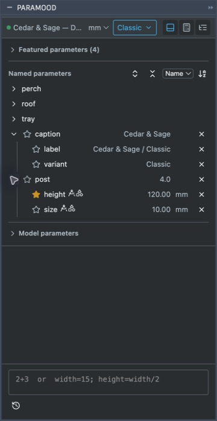
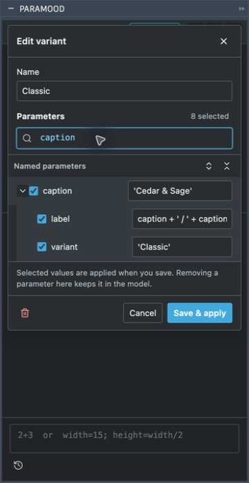
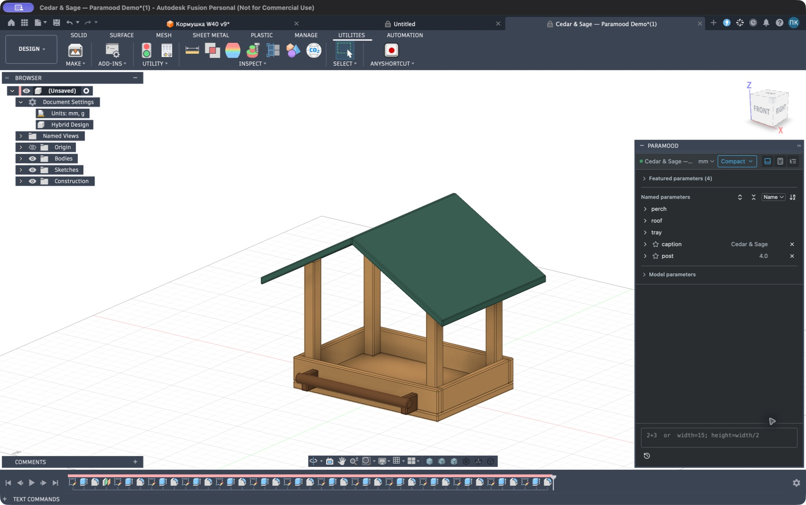
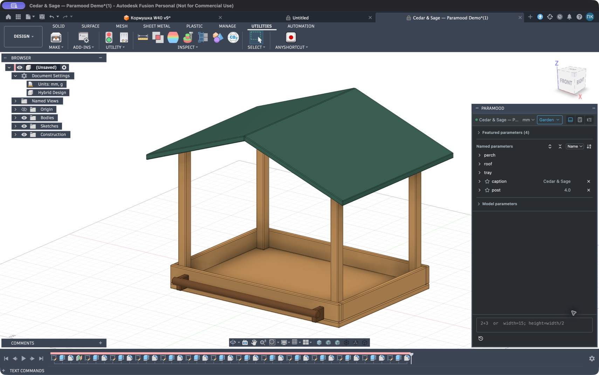

# Cedar & Sage — variants walkthrough

[Русский](DEMO.ru.md) · [User guide](USER_GUIDE.md)

The [Cedar & Sage F3D](../examples/cedar-sage/Cedar-Sage-Paramood.f3d) includes three variants with eight parameter entries each. It was exported in healthy Classic, reopened from that exact file, and switched through Compact and Garden using the installed palette. All 24 member identities resolved; each configuration retained 14 healthy bodies in Fusion 2706.1.17 on macOS. The model was returned to Classic. See [model information and SHA-256](../examples/cedar-sage/model-info.json). Native Windows validation remains outstanding.

## Open the example

1. Install the Paramood version that includes variants and text parameters, and enable **Run on Startup**.
2. Download [Cedar-Sage-Paramood.f3d](../examples/cedar-sage/Cedar-Sage-Paramood.f3d) from this repository. Save the actual F3D file rather than the GitHub HTML page.
3. In Fusion, open the F3D from your computer and make that document active. Paramood should show **Cedar & Sage — Paramood Demo**, or the imported file name, in its header.
4. Open the variant menu. Select **Classic**, **Compact**, or **Garden** and inspect the feeder geometry after each switch.

The four geometry controls used by this walkthrough are:

| Fusion parameter | Paramood path | Classic | Compact | Garden |
| --- | --- | --- | --- | --- |
| `tray_width` | `tray.width` | 180 mm | 140 mm | 220 mm |
| `tray_depth` | `tray.depth` | 130 mm | 100 mm | 160 mm |
| `post_height` | `post.height` | 120 mm | 100 mm | 150 mm |
| `roof_pitch` | `roof.pitch` | 25 deg | 30 deg | 20 deg |

The variant name is a saved parameter set. Select **Free** to keep the current dimensions while making independent changes. Save or export your own copy after experimenting.

## Understand groups that also have a value

The example includes both a parameter and a similarly named group:

- `post=4 n` is an independent dimensionless parameter (Fusion may display the expression as `4`); `post_height` appears inside the virtual `post` group as `post.height`.
- `caption='Cedar & Sage'` is an independent text parameter. `caption_variant='Classic'` and `caption_label=caption+' / '+caption_variant` appear inside the virtual `caption` group as `caption.variant` and `caption.label`.

The parent row keeps its own editable value while its arrow expands the grouped child parameters. Edit the parent value or expand the children independently. Typing `post.` or `caption.` narrows completion to the group's members. Original names such as `post_height` also work. Grouping does not create CAD objects or link the independent parent parameter to its children.



## Compare and edit configurations

1. Select **Compact**.
2. Open its pencil editor and find `tray.width` with IntelliSense.
3. Enter `tray.width=145mm` in the variant parameter search. The width is selected and its expression changes in the draft; the model does not change yet.
4. Choose **Save & apply** to apply the change and update Compact.
5. Select Classic, then Compact, to compare configurations. Changes through the main Paramood input or inline list also update the active variant and add changed parameters to it.

Use **Free** before an edit that should leave the provided variants unchanged. To restore the example's original Compact dimensions, edit the variant back to the table values or reopen an unchanged downloaded copy.

The variant editor shows the same parent-and-child structure and saves the draft explicitly.



## Work with text

Find the `caption` row and expand its children. In Classic, `caption.variant` stores `Classic`; `caption.label` computes `Cedar & Sage / Classic` from the source formula `caption+' / '+caption_variant`. The list displays the computed text; the formula remains stored as an expression.

For a separate exercise, choose Free and enter:

```text
caption='My feeder'; caption.variant='Custom'
```

Review the preview, then choose **Apply parameters**. The caption becomes `My feeder`; the existing `caption.label` formula computes `My feeder / Custom`. To include those changes in a saved configuration, perform them while the intended variant is active, or edit that variant and select the relevant text parameters.

This changes labels stored as text parameters. It does not promise an engraved or embossed label in the model geometry.

## The supplied configurations in Fusion

**Compact**: 140 × 100 mm tray, 100 mm post height, 30 deg roof pitch.



**Garden**: 220 × 160 mm tray, 150 mm post height, 20 deg roof pitch.



## Verify a copy you share

1. Select a healthy supplied configuration and inspect the timeline and geometry.
2. Export your copy as F3D using Fusion.
3. Open that exported F3D as a separate document with Paramood running.
4. Confirm that the variant names and member expressions are present; switch variants and check geometry and text again.

The variants are inside the model's design attributes, so no separate settings file is needed. A reopened design selects the first fully matching variant, or Free if no saved set matches. Windows validation remains a separate acceptance task.
