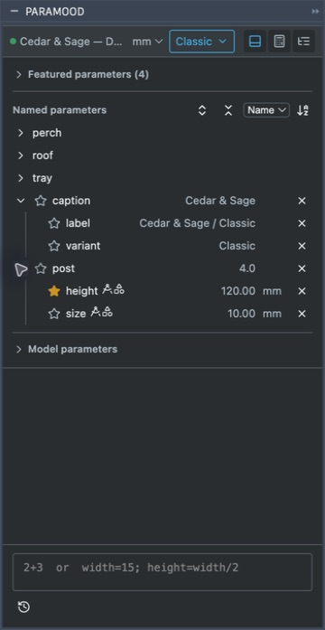
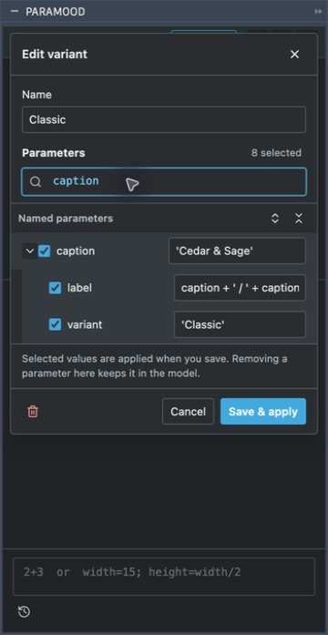
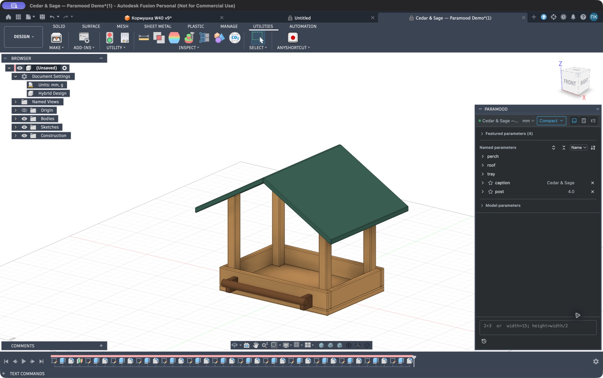
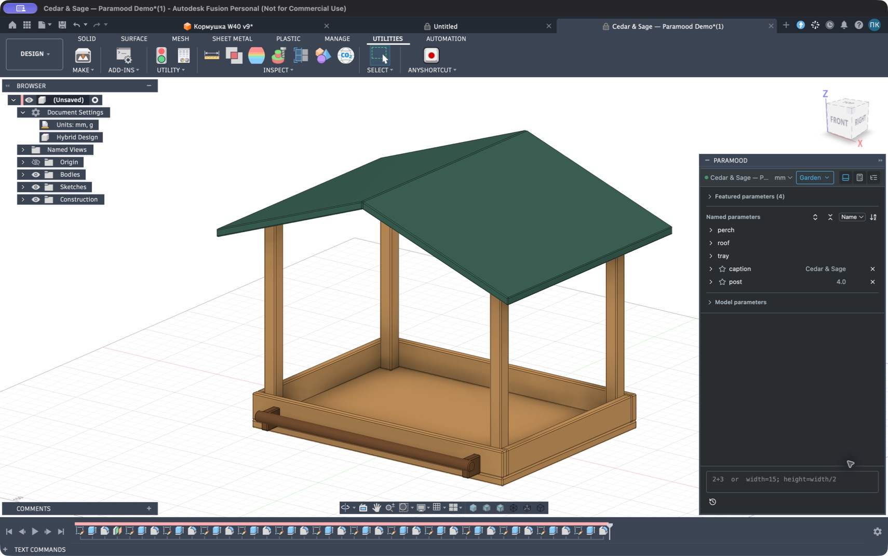

# Cedar & Sage — пример работы с вариантами

[English](DEMO.md) · [Руководство](USER_GUIDE.ru.md)

> **Пример для 1.x.** Приложенный F3D и снимки относятся к формату и интерфейсу вариантов 1.x. Paramood 2.0 не читает и не переносит эти варианты. Экспорт примера 2.0 и обновлённое руководство ещё готовятся; приведённые ниже действия с редактором вариантов не подходят для 2.0.

[F3D Cedar & Sage](../examples/cedar-sage/Cedar-Sage-Paramood.f3d) содержит три варианта по восемь параметров. Модель экспортирована в исправном Classic, повторно открыта именно из этого файла и переключена через установленную палитру на Compact и Garden. Все 24 участника разрешились в параметры; каждая конфигурация сохранила 14 исправных тел в Fusion 2706.1.17 на macOS. После проверки восстановлен Classic. См. [данные модели и SHA-256](../examples/cedar-sage/model-info.json). Нативная проверка Windows не завершена.

## Открытие примера

1. Установи версию Paramood с вариантами и строковыми параметрами, включи **Run on Startup**.
2. Скачай из репозитория [Cedar-Sage-Paramood.f3d](../examples/cedar-sage/Cedar-Sage-Paramood.f3d). Сохрани сам F3D, а не HTML-страницу GitHub.
3. В Fusion открой F3D с компьютера и сделай этот документ активным. В шапке Paramood должно появиться **Cedar & Sage — Paramood Demo** или имя импортированного файла.
4. Открой меню вариантов, выбери **Classic**, **Compact** или **Garden** и проверь геометрию кормушки после каждого переключения.

В примере используются четыре геометрических параметра:

| Параметр Fusion | Путь Paramood | Classic | Compact | Garden |
| --- | --- | --- | --- | --- |
| `tray_width` | `tray.width` | 180 mm | 140 mm | 220 mm |
| `tray_depth` | `tray.depth` | 130 mm | 100 mm | 160 mm |
| `post_height` | `post.height` | 120 mm | 100 mm | 150 mm |
| `roof_pitch` | `roof.pitch` | 25 deg | 30 deg | 20 deg |

Имя варианта обозначает сохранённый набор параметров. Выбери **Free**, чтобы оставить текущие размеры и вносить независимые правки. После экспериментов сохрани или экспортируй собственную копию.

## Параметр и одноимённая группа

Пример содержит одновременно самостоятельный параметр и группу с похожим именем:

- `post=4 n` — самостоятельный безразмерный параметр (Fusion может показывать выражение как `4`); `post_height` находится внутри виртуальной группы `post` как `post.height`.
- `caption='Cedar & Sage'` — самостоятельная строка. `caption_variant='Classic'` и `caption_label=caption+' / '+caption_variant` находятся внутри виртуальной группы `caption` как `caption.variant` и `caption.label`.

Родительская строка сохраняет собственное редактируемое значение, а стрелка раскрывает дочерние параметры группы. Значение родителя и дочерние строки доступны независимо. Ввод `post.` или `caption.` ограничивает подсказки участниками группы. Исходные имена, например `post_height`, тоже работают. Группировка не создаёт CAD-объекты и не связывает самостоятельный родительский параметр с дочерними.



## Сравнение и изменение конфигураций

1. Выбери **Compact**.
2. Открой его редактор карандашом и найди `tray.width` с помощью IntelliSense.
3. В поиске параметров варианта введи `tray.width=145mm`. Параметр выберется, выражение изменится в черновике; модель пока останется прежней.
4. Нажми **Save & apply**, чтобы применить изменение и обновить Compact.
5. Переключись на Classic и обратно на Compact для сравнения. Правки через основное поле и список тоже обновляют активный вариант и добавляют изменённые параметры.

Для эксперимента без изменения подготовленных вариантов сначала выбирай **Free**. Чтобы восстановить Compact, верни табличные значения в редакторе варианта либо снова открой неизменённый скачанный файл.

Редактор варианта показывает ту же структуру родителя и дочерних параметров; черновик сохраняется явно.



## Работа со строками

Найди строку `caption` и раскрой её дочерние параметры. В Classic параметр `caption.variant` хранит `Classic`, а `caption.label` вычисляет `Cedar & Sage / Classic` по исходной формуле `caption+' / '+caption_variant`. Список показывает вычисленный текст; формула хранится как выражение.

Для отдельного упражнения выбери Free и введи:

```text
caption='Моя кормушка'; caption.variant='Custom'
```

Проверь предпросмотр и нажми **Apply parameters**. Подпись станет `Моя кормушка`, существующая формула `caption.label` вычислит `Моя кормушка / Custom`. Для включения изменений в сохранённую конфигурацию выполни правки при активном нужном варианте либо выбери соответствующие строки в его редакторе.

Упражнение меняет текстовые параметры. Оно не обещает появления гравировки или рельефной надписи на геометрии.

## Подготовленные конфигурации в Fusion

**Compact**: лоток 140 × 100 mm, стойки 100 mm, наклон крыши 30 deg.



**Garden**: лоток 220 × 160 mm, стойки 150 mm, наклон крыши 20 deg.



## Проверка передаваемой копии

1. Выбери исправную подготовленную конфигурацию и проверь timeline и геометрию.
2. Экспортируй копию в F3D средствами Fusion.
3. Открой именно экспортированный F3D отдельным документом с включённым Paramood.
4. Проверь имена вариантов и выражения участников, снова переключи конфигурации и проверь геометрию и строки.

Варианты находятся в атрибутах модели, отдельный файл настроек не нужен. При открытии выбирается первый полностью совпавший вариант, иначе Free. Приёмка Windows остаётся отдельной задачей.
