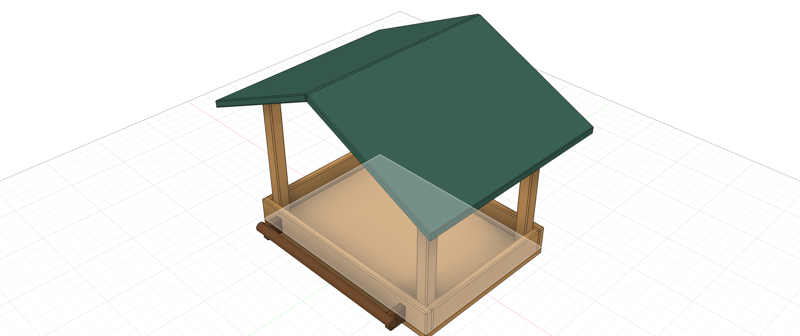
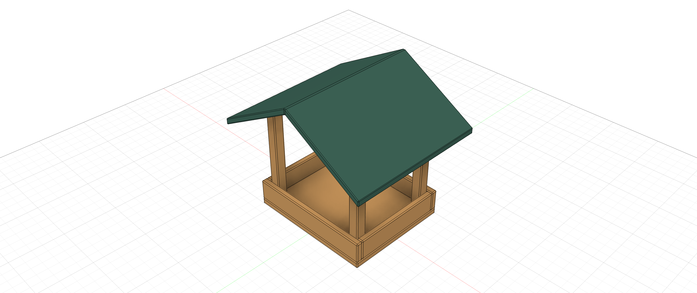
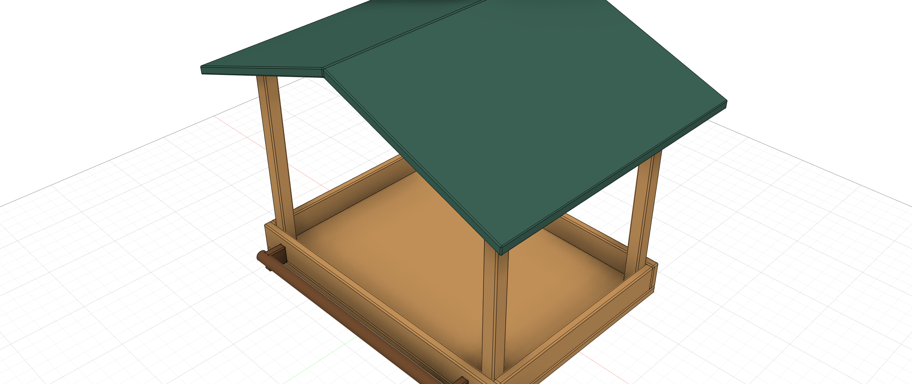

# Cedar & Sage — Paramood 2.0 demo

[Русский](DEMO_V2_DRAFT.ru.md) · [Variant workflow](VARIANTS_V2.md)

The [2.0 demo export](../examples/cedar-sage-v2/Cedar-Sage-Paramood-2-review.f3d) was reopened and its three variants applied through the source-loaded palette in Fusion 2706.1.17 on macOS. All 11 columns resolved. The repository's existing [Cedar & Sage file](../examples/cedar-sage/Cedar-Sage-Paramood.f3d) is a 1.x example; its saved variants do not appear in 2.0. Do not treat it as the 2.0 demo.

## Explore the variant table

Open the verified 2.0 demo in Fusion with Paramood running. Open the variant switcher and choose **Edit variants** in its header. The table uses one configured set for the model: each variant is a row, each selected parameter or timeline feature a column. A checked feature is **Enabled**; unchecked means **Suppressed**.

The example model contains the following saved expressions and states. The Compact width is 120 mm, as confirmed by the owner.

| Variant | Tray width | Tray depth | Post height | Roof pitch | Perch features |
| --- | --- | --- | --- | --- | --- |
| Classic | 180 mm | 130 mm | 120 mm | 25 deg | Enabled |
| Compact | 120 mm | 100 mm | 100 mm | 30 deg | Suppressed |
| Garden | 220 mm | 160 mm | 150 mm | 20 deg | Enabled |

Each row also contains `caption_variant` with its variant name. Six configured Perch features represent the two supports, landing rail and their softened edges. Other model parameters are global. The `post=4` parameter is not configured; its role in the demo is undecided.

Select a different variant from the header to apply it. Inspect the geometry, caption and timeline. To make a private experiment, open **Edit variants**, click a cell and edit its expression. The table is a draft until **Save**; **Cancel** discards edits after confirmation. Save validates all rows and applies a changed active row; other rows are stored without switching. **Free** keeps the current model state without applying a row. Editing an outside-set parameter does not add it to the table.

The cell editor supports IntelliSense, `this`, relative edits and supported creation/linking expressions. New CAD parameters are created only on Save. A table icon in the main parameter list marks configured parameters.

## Share a copy

Download the linked F3D and open it in Fusion with Paramood 2.0. Save your own copy for experiments. A valid expression can still result in a Fusion timeline warning or error; inspect the model before sharing. Paramood stores its own variant data in the design and does not use Autodesk Configuration API. This workflow does not claim full Fusion Configurations parity.

The example export SHA-256 is `853d7084c86c46380adfdaa9f442d410e5b262df4caea0eb4b75cf79bd37e639`. The installed package has had a scoped macOS UI check; native Windows validation remains outstanding.

These are Fusion graphics-view captures of the reopened example, not palette screenshots.
