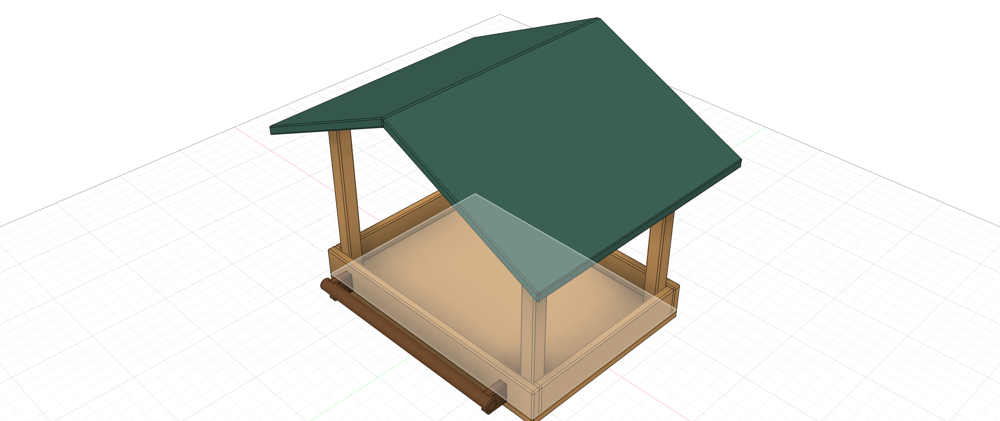
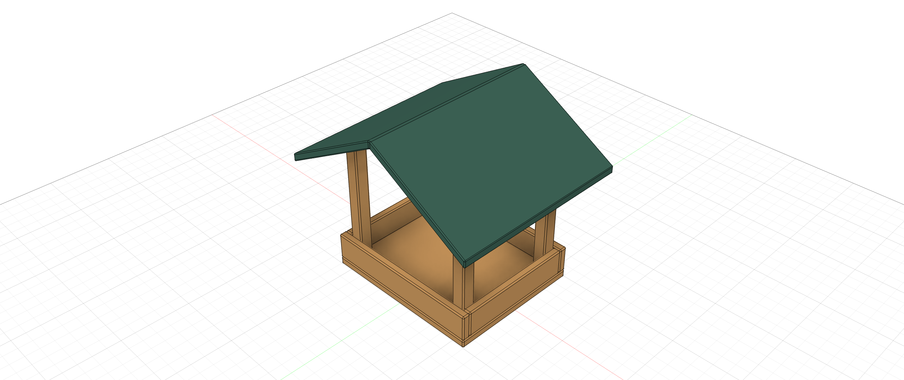
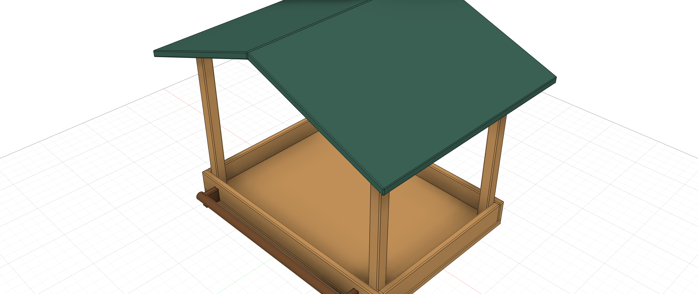

# Cedar & Sage — пример Paramood 2.0

[English](DEMO_V2_DRAFT.md) · [Работа с вариантами](VARIANTS_V2.ru.md)

[Экспорт примера 2.0](../examples/cedar-sage-v2/Cedar-Sage-Paramood-2-review.f3d) повторно открыт и три варианта применены через палитру, загруженную из исходного кода, в Fusion 2706.1.17 на macOS. Все 11 столбцов найдены. Существующий [файл Cedar & Sage](../examples/cedar-sage/Cedar-Sage-Paramood.f3d) относится к 1.x; его сохранённые варианты не отображаются в 2.0. Не используй его как пример 2.0.

## Таблица вариантов

Открой проверенный пример 2.0 во Fusion с запущенным Paramood. В меню переключателя выбери **Edit variants** в шапке. Таблица использует один набор для модели: варианты представлены строками, выбранные параметры и фичи timeline — столбцами. Галочка фичи означает **Enabled**, снятая — **Suppressed**.

В текущей проверочной модели сохранены следующие выражения и состояния. Ширина Compact — 120 мм, как подтвердил владелец.

| Вариант | Ширина лотка | Глубина лотка | Высота стоек | Угол крыши | Фичи Perch |
| --- | --- | --- | --- | --- | --- |
| Classic | 180 mm | 130 mm | 120 mm | 25 deg | Enabled |
| Compact | 120 mm | 100 mm | 100 mm | 30 deg | Suppressed |
| Garden | 220 mm | 160 mm | 150 mm | 20 deg | Enabled |

Каждая строка также содержит `caption_variant` с названием варианта. Шесть фич Perch представляют две опоры, жердочку и скругления их краёв. Остальные параметры модели глобальны. Параметр `post=4` не входит в таблицу; его роль в примере ещё не определена.

Выбери другой вариант в шапке, чтобы применить его. Проверь геометрию, подпись и timeline. Для эксперимента открой **Edit variants**, нажми ячейку и измени выражение. До **Save** таблица остаётся черновиком; **Cancel** отбрасывает правки после подтверждения. Save проверяет все строки и применяет изменённую активную строку; остальные сохраняются без переключения. **Free** сохраняет текущее состояние модели, не применяя строку. Правка параметра вне набора не добавляет его в таблицу.

Редактор ячеек поддерживает IntelliSense, `this`, относительные правки и поддерживаемые выражения создания и связывания. Новые CAD-параметры создаются только при Save. Иконка таблицы в основном списке отмечает параметры набора.

## Передача копии

После проверки итогового экспорта скачай сам F3D и открой его во Fusion с Paramood 2.0. Для экспериментов сохрани собственную копию. Корректное выражение всё же может вызвать предупреждение или ошибку timeline Fusion; перед передачей проверь модель. Paramood хранит собственные данные вариантов в модели и не использует Autodesk Configuration API. Полная эквивалентность Fusion Configurations не заявляется.

SHA-256 экспорта примера: `853d7084c86c46380adfdaa9f442d410e5b262df4caea0eb4b75cf79bd37e639`. Установленный пакет прошёл ограниченную проверку интерфейса на macOS; нативная проверка Windows ещё не завершена.

Это снимки области модели Fusion после открытия проверочной копии, не скриншоты палитры.
